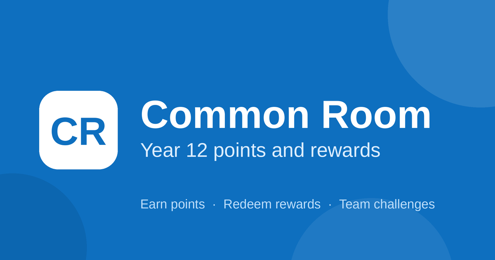

<p align="center">
  
</p>

<h1 align="center">Common Room</h1>

<p align="center">
  A points, rewards and community platform for the Year 12 common room.<br>
  Students earn points for helping out and spend them on rewards. The committee runs everything from one place.
</p>

<p align="center">
  
  
  
  
  
</p>

---

## Contents

- [What it does](#what-it-does)
- [How points work](#how-points-work)
- [Tech stack](#tech-stack)
- [Getting started](#getting-started)
- [Environment variables](#environment-variables)
- [Database setup](#database-setup)
- [Project structure](#project-structure)
- [Roles and permissions](#roles-and-permissions)
- [Security model](#security-model)
- [Audit log](#audit-log)
- [Suggestions and reports](#suggestions-and-reports)
- [Deploying to Vercel](#deploying-to-vercel)
- [Running it day to day](#running-it-day-to-day)
- [Known limitations](#known-limitations)
- [Documentation](#documentation)

---

## What it does

Common Room has two experiences in one website. Each person only sees the tools for their role.

### Students

| Page | What students can do |
|------|----------------------|
| **Dashboard** | See available points, points held for pending reward requests, recent activity, request status, announcements and challenges |
| **Jobs** | Submit a finished job and track it while it waits for review |
| **Rewards** | Browse rewards and request one (the cost is held straight away) |
| **Leaderboard** | See the top 10 by points earned and their own rank, only when the committee turns it on |
| **Feedback** | Send a suggestion or a report, and see the status and the committee's reply |
| **Account** | Change their own password |

The student area is built to work well on a phone, with a bottom navigation bar on small screens.

### Committee

| Area | What the committee can do |
|------|---------------------------|
| **Overview** | See student count, pending reviews and recent activity |
| **Award Points** | Give or take away points with a recorded reason |
| **Review Queue** | Approve or decline job submissions and reward requests. A reason is required when declining, and the student sees it |
| **Inbox** | Read suggestions and reports, set a status and reply to the student |
| **Students** | Search every balance by name or username, and reset a forgotten password |
| **Add Students** | Create accounts in bulk from a pasted list of names, with generated usernames and random passwords (downloadable as CSV) |
| **Jobs / Rewards** | Add, edit, hide or show items, and choose which jobs students can submit themselves |
| **Challenges** | Set shared goals, track progress and pay out a reward to every student once |
| **Announcements** | Post updates that appear on every student dashboard |
| **Settings** | Turn the leaderboard on or off |
| **Audit Log** | Admins only: a permanent record of who did what and when, with an optional live feed to a private Discord channel |
| **My Account** | Change their own password |

---

## How points work

- **The ledger is the source of truth.** A student's balance is never stored as a number. It is the sum of every row in `transactions`, and each row records the amount, reason, who made it and when.
- **Nothing is edited or deleted.** Mistakes are fixed by adding a correcting transaction, so history can always be traced.
- **Held points.** Requesting a reward holds its cost immediately, so the same points cannot be spent twice. `available = balance - points held by pending requests`.
- **Approving a job** adds the job's points. **Approving a reward** deducts its cost. **Declining a reward** releases the held points.
- **One review only.** Review updates only apply while a request is still `pending`, so a double-click cannot award or deduct twice.
- **Leaderboard** ranks by total points earned (positive transactions), so spending on rewards does not push a student down the table.
- **Challenge payouts** can only happen once. The challenge is marked completed first, then one transaction is written per student. If that fails, the challenge is put back to active.

---

## Tech stack

| Layer | Technology |
|-------|------------|
| Framework | Next.js (App Router) with TypeScript |
| Styling | Tailwind CSS |
| Database | PostgreSQL on Supabase |
| Passwords | bcryptjs |
| Sessions | Signed, HttpOnly cookies using `jose` |
| Hosting | Vercel |

The browser never talks to the database. Every request goes through a Next.js API route that checks the session first, then uses the Supabase **service role** key on the server.

---

## Getting started

### Prerequisites

- Node.js 20.9 or newer
- A free [Supabase](https://supabase.com) project
- Git

### Run it locally

```bash
git clone <your-repo-url>
cd common-room-v1
npm install
```

1. Create the database tables (see [Database setup](#database-setup)).
2. Create a `.env.local` file in the project root (see [Environment variables](#environment-variables)).
3. Start the development server:

```bash
npm run dev
```

Open [http://localhost:3000](http://localhost:3000) and sign in with the admin account you created.

### Useful scripts

| Command | What it does |
|---------|--------------|
| `npm run dev` | Start the development server |
| `npm run build` | Create a production build (also a good check before pushing) |
| `npm start` | Run the production build locally |
| `npm run lint` | Run the linter |

---

## Environment variables

Create `.env.local` in the project root. **Never commit this file.**

```bash
# Supabase project URL (Project Settings > API)
NEXT_PUBLIC_SUPABASE_URL=https://your-project.supabase.co

# Supabase service role key (Project Settings > API). Server only, keep it secret.
SUPABASE_SERVICE_ROLE_KEY=your-service-role-key

# Long random string used to sign login cookies
SESSION_SECRET=your-long-random-string

# Optional: Discord webhook for the admin audit feed (see Audit log)
DISCORD_WEBHOOK_URL=
```

Generate a session secret with:

```bash
node -e "console.log(require('crypto').randomBytes(32).toString('hex'))"
```

| Variable | Used for |
|----------|----------|
| `NEXT_PUBLIC_SUPABASE_URL` | Address of your Supabase project |
| `SUPABASE_SERVICE_ROLE_KEY` | All database access, from the server only. Has full access, so never expose it to the browser |
| `SESSION_SECRET` | Signing login cookies. Changing it signs everyone out |
| `DISCORD_WEBHOOK_URL` | Optional. Posts audit events to a private Discord channel. Anyone with this URL can post to the channel, so keep it secret |

`NEXT_PUBLIC_SUPABASE_PUBLISHABLE_KEY` may also appear in older setups. The app does not currently use it.

---

## Database setup

Open the Supabase **SQL Editor** and run the script below once. It creates every table, the balances view, and locks the tables so that only the server (using the service role key) can read or write them.

<details>
<summary><strong>Click to expand the full setup script</strong></summary>

```sql
-- ============ Accounts ============
create table users (
  id uuid primary key default gen_random_uuid(),
  first_name text not null,
  last_name text not null,
  username text not null unique,
  password_hash text not null,
  role text not null default 'student' check (role in ('student', 'committee', 'admin')),
  created_at timestamptz default now()
);

-- ============ Points ledger (rows are never edited or deleted) ============
create table transactions (
  id uuid primary key default gen_random_uuid(),
  user_id uuid not null references users(id),
  amount integer not null,
  reason text not null,
  awarded_by uuid references users(id),
  created_at timestamptz default now()
);

-- ============ Rewards and redemption requests ============
create table rewards (
  id uuid primary key default gen_random_uuid(),
  name text not null,
  description text,
  cost integer not null,
  available boolean default true,
  stock integer,
  created_at timestamptz default now()
);

create table redemptions (
  id uuid primary key default gen_random_uuid(),
  user_id uuid not null references users(id),
  reward_id uuid not null references rewards(id),
  status text not null default 'pending' check (status in ('pending', 'approved', 'declined')),
  reviewed_by uuid references users(id),
  decline_reason text,
  created_at timestamptz default now()
);

-- ============ Jobs and job submissions ============
create table jobs (
  id uuid primary key default gen_random_uuid(),
  name text not null,
  description text,
  points integer not null,
  student_submittable boolean default true,
  active boolean default true,
  created_at timestamptz default now()
);

create table job_submissions (
  id uuid primary key default gen_random_uuid(),
  user_id uuid not null references users(id),
  job_id uuid not null references jobs(id),
  status text not null default 'pending' check (status in ('pending', 'approved', 'declined')),
  reviewed_by uuid references users(id),
  decline_reason text,
  created_at timestamptz default now()
);

-- ============ Announcements, challenges, settings ============
create table announcements (
  id uuid primary key default gen_random_uuid(),
  title text not null,
  body text not null,
  created_by uuid references users(id),
  created_at timestamptz default now()
);

create table challenges (
  id uuid primary key default gen_random_uuid(),
  title text not null,
  description text,
  goal integer not null check (goal > 0),
  progress integer not null default 0,
  reward_points integer not null default 0,
  status text not null default 'active' check (status in ('active', 'completed', 'archived')),
  created_at timestamptz default now(),
  completed_at timestamptz
);

create table settings (
  key text primary key,
  value text not null
);

insert into settings (key, value) values ('leaderboard_enabled', 'false');

-- ============ Login rate limiting ============
create table login_attempts (
  id uuid primary key default gen_random_uuid(),
  username text not null,
  ip text not null,
  created_at timestamptz not null default now()
);

create index login_attempts_username_idx on login_attempts (username, created_at);
create index login_attempts_ip_idx on login_attempts (ip, created_at);

-- ============ Suggestions and reports ============
create table feedback (
  id uuid primary key default gen_random_uuid(),
  created_at timestamptz not null default now(),
  user_id uuid references users(id) on delete set null,
  type text not null check (type in ('suggestion', 'report')),
  category text not null check (category in (
    'job_idea', 'reward_idea', 'other_suggestion',
    'supplies', 'broken', 'behaviour', 'other_report'
  )),
  message text not null,
  hide_name boolean not null default false,
  status text not null default 'new' check (status in ('new', 'reviewing', 'done', 'dismissed')),
  response text,
  responded_by uuid references users(id) on delete set null,
  responded_at timestamptz
);

create index feedback_status_idx on feedback (status, created_at desc);
create index feedback_user_idx on feedback (user_id, created_at desc);

-- ============ Audit log (append-only record of what happened) ============
create table audit_log (
  id uuid primary key default gen_random_uuid(),
  created_at timestamptz not null default now(),
  action text not null,
  actor_id uuid references users(id) on delete set null,
  actor_name text,
  actor_role text,
  target_user_id uuid references users(id) on delete set null,
  target_name text,
  summary text not null,
  details jsonb not null default '{}'::jsonb,
  ip text
);

create index audit_log_created_idx on audit_log (created_at desc);
create index audit_log_action_idx on audit_log (action, created_at desc);

-- ============ Balances view (used by the Students list and the leaderboard) ============
create view student_balances as
select
  u.id, u.first_name, u.last_name, u.username,
  coalesce(sum(t.amount), 0)::int as balance,
  coalesce(sum(t.amount) filter (where t.amount > 0), 0)::int as earned
from users u
left join transactions t on t.user_id = u.id
where u.role = 'student'
group by u.id;

revoke all on student_balances from anon, authenticated;

-- ============ Lock everything down ============
-- Row Level Security on with no policies means the public API key can read nothing.
-- Only the server, using the service role key, can access the data.
alter table users enable row level security;
alter table transactions enable row level security;
alter table rewards enable row level security;
alter table redemptions enable row level security;
alter table jobs enable row level security;
alter table job_submissions enable row level security;
alter table announcements enable row level security;
alter table challenges enable row level security;
alter table settings enable row level security;
alter table login_attempts enable row level security;
alter table audit_log enable row level security;
alter table feedback enable row level security;
```

</details>

### Create the first admin account

1. Generate a password hash from inside the project folder:

   ```bash
   node -e "require('bcryptjs').hash('choose-a-strong-password', 10).then(console.log)"
   ```

2. Insert the admin, pasting the hash in:

   ```sql
   insert into users (first_name, last_name, username, password_hash, role)
   values ('Admin', 'User', 'admin', 'PASTE_THE_HASH_HERE', 'admin');
   ```

3. Sign in, open **My Account** and change the password to one only you know.

### Optional starter content

```sql
insert into jobs (name, description, points) values
  ('Tidy common room', 'General tidy up of the space', 10),
  ('Restock fridge', 'Refill the drinks fridge', 8),
  ('Wipe tables', 'Clean down all the tables', 5);

insert into rewards (name, description, cost) values
  ('Cafe voucher', 'A voucher for the cafe', 20),
  ('Pizza day vote', 'Vote on the next pizza day', 10);
```

---

## Project structure

```
src/
├── app/
│   ├── page.tsx                  Login page
│   ├── layout.tsx                Root layout and share-preview metadata
│   ├── (student)/                Student area, shares one layout (sidebar and sign-in check)
│   │   ├── dashboard/
│   │   ├── jobs/
│   │   ├── rewards/
│   │   ├── leaderboard/
│   │   ├── feedback/
│   │   └── account/
│   ├── committee/                Committee dashboard (tabbed)
│   └── api/
│       ├── auth/                 login, logout, me, change-password
│       ├── committee/            award, submissions, redemptions, students, transactions,
│       │                         create-students, reset-password, jobs, rewards,
│       │                         announcements, challenges, settings
│       └── ...                   summary, jobs, rewards, submissions, redemptions,
│                                 announcements, challenges, leaderboard (student-facing)
├── components/
│   ├── StudentShell.tsx          Student layout and useStudent() hook
│   ├── ChangePasswordForm.tsx
│   └── committee/                ItemsManager, AnnouncementsManager,
│                                 ChallengesManager, SettingsPanel, AuditLog,
│                                 FeedbackInbox
└── lib/
    ├── session.ts                Cookie sessions and requireRole() guard
    ├── audit.ts                  logAudit(): saves an event and posts it to Discord
    ├── audit-meta.ts             Event types, labels, emoji and colours
    ├── discord.ts                Sends embeds to the Discord webhook
    ├── feedback-meta.ts          Suggestion and report categories and statuses
    ├── supabase-server.ts        Service-role database client (server only)
    └── supabase.ts               Public client (not currently used)

public/
└── og-image.png                  Link preview image (1200 x 630)
```

The `(student)` folder is a Next.js route group. The brackets keep the files organised without changing the web addresses, so `/dashboard` is still `/dashboard`.

---

## Roles and permissions

| Role | Can do |
|------|--------|
| **student** | View their own data, submit jobs, request rewards, view challenges and announcements, change their own password |
| **committee** | Everything in the committee area, including creating students and resetting **student** passwords |
| **admin** | Everything a committee member can do, plus resetting **any** account's password and viewing the audit log |

Committee and admin accounts are created by promoting an existing student in the SQL Editor:

```sql
update users set role = 'committee' where username = 'their_username';
```

Use `'admin'` instead of `'committee'` for an admin. Every committee member should change their password under **My Account** straight away.

---

## Security model

- **Passwords** are hashed with bcrypt and never stored or logged in plain text. New passwords must be at least 8 characters, and generated passwords are random.
- **Sessions** are signed, `HttpOnly` cookies (7 days, `SameSite=Lax`, `Secure` in production). The token only holds the user ID. The role is looked up from the database on every request, so changes and deleted accounts take effect immediately.
- **Every API route checks the session on the server** with `requireRole()`. User IDs are never trusted from the request, so one student cannot ask for another student's data.
- **The database is closed to the public.** Row Level Security is on with no policies, and the balances view has public access revoked. Only the server's service role key can read or write.
- **Login rate limiting.** 8 failed attempts on one username, or 100 from one IP address, within 15 minutes triggers a 15 minute block. The limits are set at the top of `src/app/api/auth/login/route.ts`.
- **Reviews are idempotent.** Approving or declining only applies to a request that is still pending.
- **Secrets stay on the server.** `SUPABASE_SERVICE_ROLE_KEY` and `SESSION_SECRET` are never sent to the browser.
- **Data collected is minimal.** First name, last name, username and a hashed password. No emails, phone numbers or school ID numbers.

If you believe you have found a security problem, please tell the maintainer directly rather than opening a public issue.

---

## Audit log

Every important action is recorded in the `audit_log` table, with the person who did it, the person it affected, the details, and the time. Admins can read it under **Audit Log** in the committee dashboard, filtered by category.

**What is recorded**

| Category | Events |
|----------|--------|
| Points | Awarded, deducted (with reason and new balance) |
| Jobs | Submitted, approved, declined, created, updated |
| Rewards | Requested, approved, declined, created, updated |
| Accounts | Students created, password reset by committee, password changed |
| Challenges | Created, progress updated, completed and paid out, removed |
| Announcements | Posted, deleted |
| Settings | Leaderboard turned on or off |
| Suggestions and reports | Sent, and status or reply updated |
| Security | Sign-ins, and sign-in lockouts |

Passwords are never written to the log. Names are saved as they were at the time, so entries still make sense if an account is later deleted.

**Discord feed (optional)**

When `DISCORD_WEBHOOK_URL` is set, each event is also posted to a private Discord channel as a colour-coded embed. Sign-ins are saved to the log but not posted. To change which events post, edit the `discord` flag for each event in `src/lib/audit-meta.ts`.

1. In Discord, open your private admin channel, then **Edit Channel > Integrations > Webhooks > New Webhook**.
2. Copy the webhook URL.
3. Add it as `DISCORD_WEBHOOK_URL` in `.env.local` and in the Vercel environment variables, then redeploy.
4. Open **Audit Log** and click **Send test message**.

Mentions such as `@everyone` in anything a user types are switched off in the messages, so they cannot ping anyone. Logging never blocks an action: if the database or Discord is unavailable, the action still goes through and the problem is written to the server logs.

---

## Suggestions and reports

Students have a **Feedback** page with two options, and the committee reads everything in the **Inbox** tab.

| Type | Categories |
|------|------------|
| Suggestion | New job idea, new reward idea, other suggestion |
| Report | Supplies needed, something broken or unsafe, behaviour or rules, other report |

- Each item has a status (new, looking into it, done, not going ahead) and an optional reply. Students see both on their Feedback page.
- A student can send up to 5 a day.
- **Hide my name.** When sending a report, a student can hide their name from the committee. Admins can still see it, and the form tells students this, so it is only for dealing with misuse.
- **Privacy for behaviour reports.** The text of a behaviour report is not copied to Discord or the audit log, which only record that one was sent. It is only readable in the Inbox.
- The form tells students to speak to a teacher about anything serious or urgent, and the Inbox reminds the committee to handle behaviour reports carefully.

Because reports can name other students, agree as a committee who reads them and what happens next before turning this on for everyone.

---

## Deploying to Vercel

1. Push the repository to GitHub.
2. In Vercel choose **Add New > Project** and import the repository. Next.js is detected automatically.
3. Add the three [environment variables](#environment-variables) before the first deploy.
4. Click **Deploy**. Every push to the main branch redeploys automatically.

**Tips**

- Set **Project Settings > Functions > Function Region** to the region closest to your Supabase project. A server far from the database makes every page noticeably slower.
- Link previews use `metadataBase` in `src/app/layout.tsx`. If the site ever moves to a custom domain, update it there.
- Vercel's free Hobby plan is for non-commercial use only.

---

## Running it day to day

- **Adding students:** Committee dashboard > **Add Students**. Passwords are shown once, so download the CSV straight away and hand each student only their own details.
- **Forgotten password:** Committee dashboard > **Students** > **Reset password**.
- **Locked out after too many attempts:** wait 15 minutes. To clear it immediately, run `delete from login_attempts;` in the SQL Editor.
- **Backups:** Supabase's free plan does not include automatic backups. Export the `users`, `transactions` and related tables from the Table Editor regularly, for example once a term.
- **Free-plan pausing:** Supabase pauses free projects after a week of inactivity, which school holidays can trigger. If the site stops working after a break, check the project in the Supabase dashboard and restore it if it is paused.

---

## Known limitations

- Reward stock is not tracked. Hide a reward manually when it runs out.
- Committee accounts are created with a SQL statement, not from inside the site.
- There is no email-based password recovery. The committee resets passwords instead.
- Sessions last 7 days and cannot be revoked one by one. Deleting a user, or changing `SESSION_SECRET`, signs people out.
- Rate limiting covers sign-in only.
- Some committee screens load their data when the page opens, so the Review Queue needs a refresh to show new requests.

---

## Documentation

If you add the printable guides to a `docs/` folder, these links will work:

- [Committee Guide](docs/common-room-committee-guide.pdf): how the committee uses the site, step by step
- [Platform Documentation](docs/common-room-documentation.pdf): how the system works, for anyone taking it over

---

## Licence

No licence has been chosen yet. Until one is added, all rights are reserved by the author.

## Author

Built by Luke for the Year 12 Common Room.